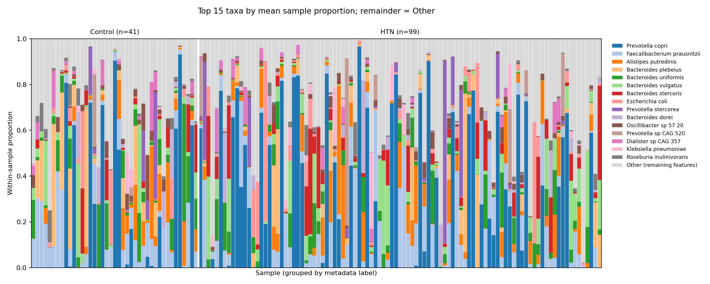
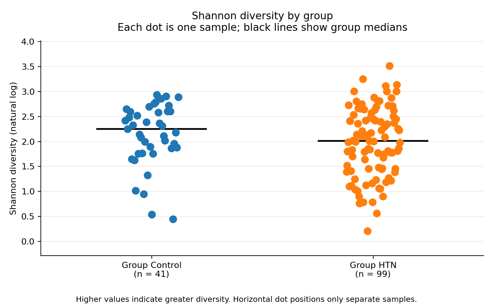
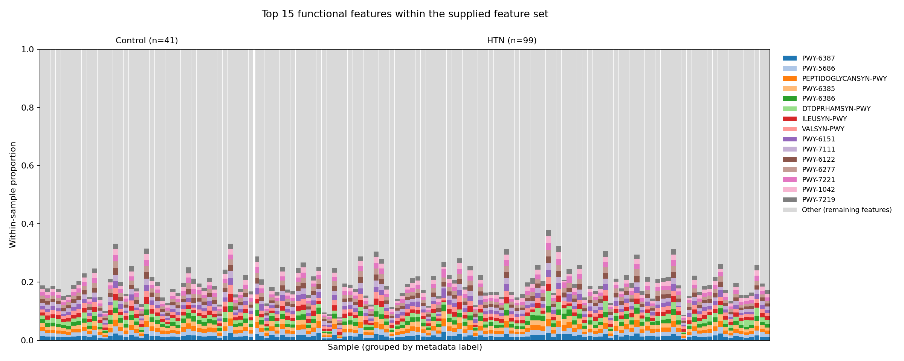
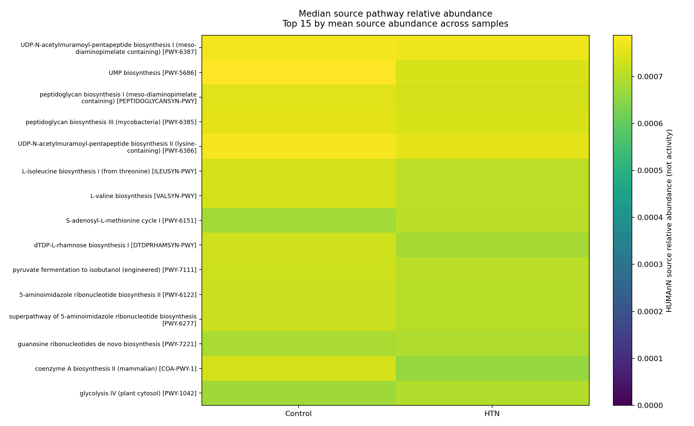

# See the result

These figures use the verified **140-sample Control versus HTN subset**. Their numerical evidence is saved in `results/hypertension/tables/`.

## Species composition

{#fig-htn-preview-composition width=100%}

Each bar sums to 1. A segment is a species' share of that sample's profiled taxonomic abundance. The same 15 species are displayed in both groups; selection uses mean proportions across all 140 samples, not a test of group differences. **Other** combines the remaining species and is not an organism.

Profiles vary substantially within groups. A large segment indicates relative dominance, not an absolute bacterial count. Group widths reflect different sample counts. Individual sample labels are omitted for readability; use `composition-display.tsv` and the complete relative-abundance table to check a sample.

## Shannon diversity

{#fig-htn-preview-shannon width=100%}

Control has a higher median Shannon value (**2.249602**) than HTN (**2.009787**), with substantial overlap. These are descriptive summaries of the curated species profiles, not a hypothesis test or a replication of the paper's diversity values.

Shannon combines detected richness and evenness. Controls have 40–118 detected species per sample; HTN samples have 24–119. Consequently, a Shannon difference cannot be attributed to evenness alone.

## Functional proportions within the named pathway set

{#fig-htn-preview-functions width=100%}

The workflow divides each source value by that sample's total over the **483 named pathways**. The bars therefore show proportions within this retained set. A share of 0.02 means 2% of the named-pathway total, not 2% of all microbial functions, genes or reads. Pathways can overlap and do not form exclusive biological categories.

## Pathway abundances on the source scale

{#fig-htn-preview-source width=100%}

This heatmap uses the original source values, without renormalizing over the 483 named pathways. The colour scale is shared across cells; it shows abundance level, not a standardized effect size. The table `pathway-source-group-medians.tsv` provides exact values. Selection is descriptive and does not identify differentially abundant pathways.

`UNMAPPED` and `UNINTEGRATED` are excluded from both pathway plots and recorded separately in `functional-denominators.tsv`. Neither plot measures pathway activity or metabolite production.

Pathway names are database annotations. A label containing “plant”, “mammalian” or “engineered” does not establish that the sample contains that organism or an engineered community; shared genes can contribute to related pathway annotations. Treat such labels as a prompt to check gene-level support and pathway definitions.

**Check your understanding:** why can changing the retained pathway set alter a normalized bar proportion while leaving the corresponding source abundance unchanged?

[Next: Meet the data](02-meet-the-data.qmd)
