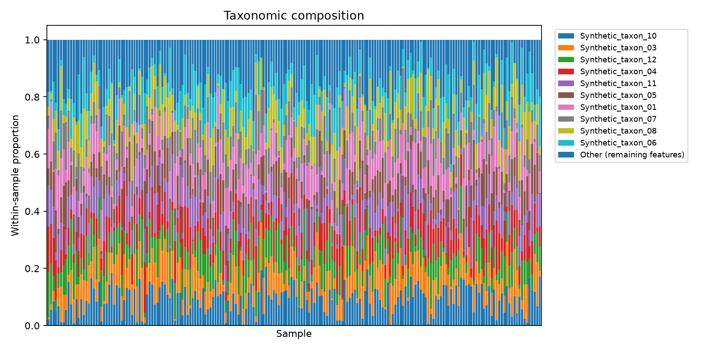
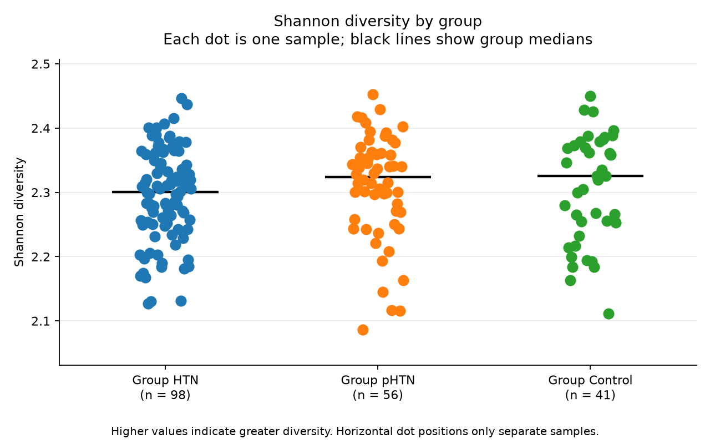

# Verify and explain

::: {.callout-warning}
The taxonomic table contains synthetic placeholder abundances. Composition and calculated Shannon diversity do not represent the hypertension study. Confirm the source and units of the functional features in `data/hypertension/README.md` before interpreting biological differences.
:::

Choose a sample ID from your metadata. Recalculate its taxon total, detected taxa and natural-log Shannon diversity:

```bash
python scripts/python/verify_sample.py data/hypertension results/hypertension YOUR_SAMPLE_ID
```

Compare the manual values with the saved results. Explain Shannon using richness and evenness. Then write one observation per figure, checking values in the tables. State limitations and a useful follow-up check.

## Taxonomic composition

{#fig-hypertension-composition width=100%}

Describe the visible variation among samples. These placeholder profiles cannot support conclusions about hypertension.

## Shannon diversity

{#fig-hypertension-shannon width=100%}

Compare group medians, spread and overlap. Use the saved `detected_taxa` values to explain whether richness, evenness or both contribute to the differences. Keep these calculated values separate from `source_shannon_index` in the metadata. This plot alone does not establish statistical significance.

## Functional profile

{#fig-hypertension-functions width=100%}

Identify the largest displayed proportions and check them against the saved table. These proportions describe only the supplied feature set. Interpretation remains provisional until the feature definitions, source and measurement units are confirmed.
