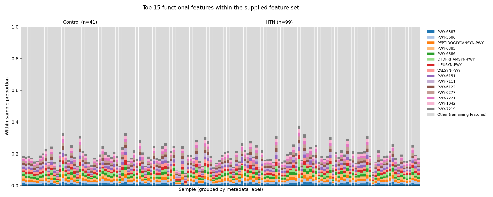
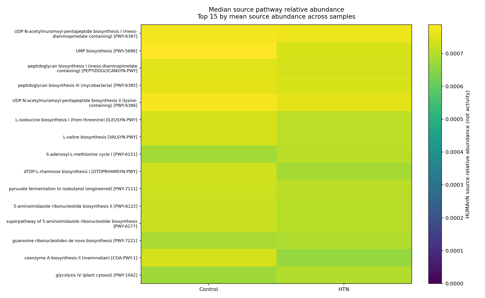

# Verify and explain

A saved result is more useful when you can trace it back to the input. Verify one sample, check a functional proportion and use numerical summaries to support what you see.

All values on this page refer to the verified 140-sample dataset. Inspect the saved tables alongside the figures.

## 1. Verify a named sample

Use **ERR1398068**. For the verified species table, expect:

| Quantity | Expected value |
|---|---:|
| Total species abundance (source percentage total) | 100.000000 |
| Detected species | 75 |
| Shannon diversity, natural logarithm | 1.394365 |

Run the supplied verification script from the main project folder:

```bash
python scripts/python/verify_sample.py \
  data/hypertension results/hypertension ERR1398068
```

Compare its reported values with the table above and with `results/hypertension/tables/alpha-diversity.tsv`.

### Recalculate independently

This block makes each calculation visible and compares it with the saved row. Copy the complete block into the terminal:

```bash
python - <<'PY'
import math
import pandas as pd

sample = "ERR1398068"
taxa = pd.read_csv("data/hypertension/taxon-abundance.tsv", sep="\t", index_col=0)
saved = pd.read_csv("results/hypertension/tables/alpha-diversity.tsv", sep="\t", index_col=0)

# Calculate this sample's total and number of positive taxon values.
x = taxa[sample].astype(float)
total = float(x.sum())
detected = int((x > 0).sum())

# Only positive values contribute to natural-log Shannon diversity.
p = x[x > 0] / total
shannon = -sum(float(value) * math.log(float(value)) for value in p)

for name, manual in [("total_abundance", total),
                     ("detected_taxa", detected),
                     ("shannon", shannon)]:
    recorded = float(saved.loc[sample, name])
    agrees = math.isclose(manual, recorded, rel_tol=1e-9, abs_tol=1e-9)
    print(f"{name}: manual={manual:.6f}; saved={recorded:.6f}; agrees={agrees}")
PY
```

All three comparisons should print `agrees=True`. A tiny difference in the last decimal places can be rounding. A larger difference calls for checking the input version, selected sample, normalization and logarithm base. Do not change a saved result merely to make it agree.

The calculated Shannon value uses the curated species table and is not a reference reproduction of the original paper's reported diversity.

## 2. Check a functional proportion

For ERR1398068, named pathway values sum to **0.045588663834** on the source scale. `DTDPRHAMSYN-PWY` has source abundance **0.00110242**. Its normalized share is **0.024181889**, or **2.4182% of the named-pathway total**. Use `functional-annotations.tsv` to look up its label.

```bash
python - <<'PY'
import math
import pandas as pd

sample = "ERR1398068"
feature = "DTDPRHAMSYN-PWY"
raw = pd.read_csv("data/hypertension/functional-features.tsv", sep="\t", index_col=0)
saved = pd.read_csv("results/hypertension/tables/functional-relative-abundance.tsv", sep="\t", index_col=0)
manual = raw.loc[feature, sample] / raw[sample].sum()
recorded = saved.loc[feature, sample]
print(f"Calculated proportion: {manual:.6f} ({100 * manual:.4f}%)")
print(f"Saved proportion:      {recorded:.6f}")
print("Agrees:", math.isclose(manual, recorded, rel_tol=1e-9, abs_tol=1e-9))
PY
```

This checks arithmetic within the retained named-pathway set. The denominator excludes UNMAPPED and UNINTEGRATED. Overlapping pathways are not exclusive parts of a biological whole; this calculation does not measure activity.

## 3. Explain taxonomic composition

{#fig-hypertension-composition width=100%}

Choose one sample with an uneven profile. Use `taxon-relative-abundance.tsv` to identify its largest taxon proportion, then write a sentence containing the sample ID, taxon ID and value. **Other** combines taxa rather than naming an organism.

**Sentence starter:** “In sample ERR1398068, s__Prevotella_copri accounts for 60.81291% of the profiled species abundance.” Check this value in the full table. A dominant species in one sample does not establish a group association.

## 4. Explain Shannon diversity

{#fig-hypertension-shannon width=100%}

Inspect sample counts, spread and overlap before comparing medians. Generate a numerical summary:

```bash
python - <<'PY'
import pandas as pd

alpha = pd.read_csv("results/hypertension/tables/alpha-diversity.tsv", sep="\t")
summary = alpha.groupby("group", sort=False).agg(
    samples=("shannon", "size"),
    median_shannon=("shannon", "median"),
    minimum_shannon=("shannon", "min"),
    maximum_shannon=("shannon", "max"),
    minimum_detected_taxa=("detected_taxa", "min"),
    maximum_detected_taxa=("detected_taxa", "max"),
)
print(summary.round(6).to_string())
PY
```

The saved group summary gives:

| Group | Samples | Median Shannon | Shannon range | Detected species range |
|---|---:|---:|---|---|
| Control | 41 | 2.249602 | 0.449661–2.936477 | 40–118 |
| HTN | 99 | 2.009787 | 0.209700–3.517295 | 24–119 |

Control has a higher median, but the distributions overlap substantially. Richness differs, so evenness alone cannot explain Shannon variation. This descriptive plot does not establish statistical significance, adjustment for confounders or causation.

**Your task:** write a two-sentence interpretation containing both medians, overlap and one limitation.

## 5. Explain the functional profile

{#fig-hypertension-functions width=100%}

Choose a visible feature and confirm one sample's proportion in the saved table. Use “larger proportion of the supplied functional total” rather than “more active pathway.” The 483 named pathways overlap, and this normalization excludes source UNMAPPED and UNINTEGRATED categories.

## 6. Check the source-scale pathway heatmap

{#fig-hypertension-source width=100%}

Choose a pathway in `pathway-source-group-medians.tsv`. Quote both group medians and look up its readable label in `functional-annotations.tsv`. The colour scale shows abundance levels on the source relative-abundance scale, not a standardized group effect or significance. These are group summaries; inspect sample-level source values before describing consistency across individuals.


Pathway names are database annotations. A label containing “plant”, “mammalian” or “engineered” does not establish that the sample contains that organism or an engineered community; shared genes can contribute to related pathway annotations. Treat such labels as a prompt to check gene-level support and pathway definitions.

## Your evidence check

Write one observation for each figure. Include a checked number, its source table, a limitation and a next check. Appropriate next checks include inspecting source-level distributions, obtaining verified covariates or planning a model suitable for relative abundance data. Never manufacture integer counts from these percentages to satisfy a count-based method.

**Ready to report:** you can reproduce the named sample and explain the two different functional denominators.

[Next: Write the report](06-export-the-report.qmd)
