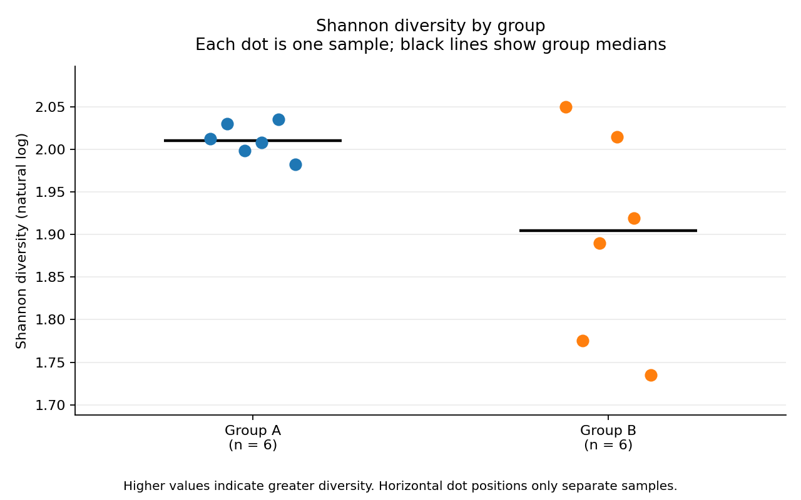
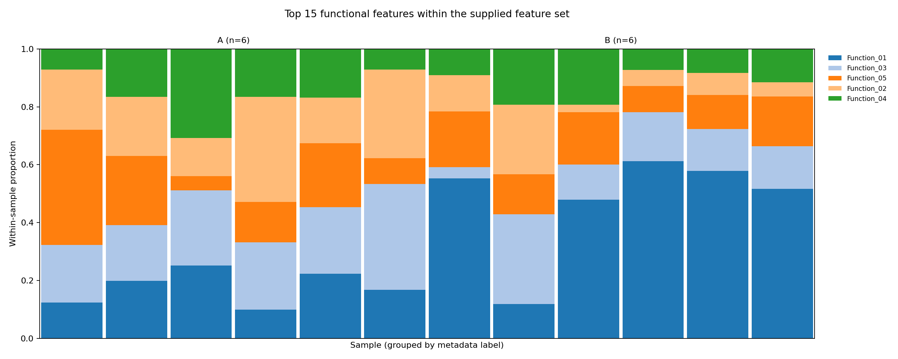

# See the result

First, look at what you will produce. These figures are read from `results/synthetic/figures/`. If they have not been generated yet, continue through the input checks and analysis, then return here.

## Composition: what makes up each sample?

{#fig-synthetic-preview-composition width=100%}

Each colour represents a taxon. Its segment height is the taxon's abundance divided by the sample's total taxonomic abundance. Every bar sums to 1, or 100%, even when original totals differ.

Compare samples with one large segment against samples with more similarly sized segments. Similar segment sizes indicate more even abundance distributions. Sample order follows the metadata; check group labels before assigning a pattern to A or B.

The script displays up to 15 taxa with the highest mean proportions. If more taxa are present, it combines the remainder as **Other**. The full relative-abundance table retains every taxon.

**Try this:** pick one bar and identify its largest segment. You will check its numerical proportion later.

## Diversity: how evenly is abundance distributed?

{#fig-synthetic-preview-shannon width=100%}

The original lesson describes Group A as having a higher median Shannon diversity and less variation than Group B, with overlap between groups. Confirm that description against your current figure and saved table before using it in your report.

- **Richness** is the number of taxa with abundance greater than zero.
- **Evenness** describes how evenly abundance is distributed among detected taxa.
- **Shannon diversity** combines richness and evenness.

This practice example is expected to have eight detected taxa per sample. Confirm that with the verification code. When richness is the same, differences in Shannon reflect evenness.

The black line is a group's median, or middle value. Look at the individual dots as well: a median does not describe all variation. Horizontal offsets only separate dots visually. This plot alone does not establish statistical significance.

## Functions: how are the fictional features distributed?

{#fig-synthetic-preview-functions width=100%}

Each functional value is divided by the total of the supplied functional values for that sample. A proportion of 0.25 therefore means 25% of that supplied total.

These are invented features, not identified pathways. You can describe their numerical patterns, but cannot infer a named pathway, biological function or measured activity from their labels.

## Check your understanding

1. Can two samples with different original totals have identical proportions? Why?
2. Can two samples with eight detected taxa have different Shannon values?
3. Does a larger functional proportion necessarily mean a larger original value?

**Ready to continue:** you can explain what one bar, one coloured segment, one dot and one median line represent.

[Next: Meet the data](02-meet-the-data.qmd)
