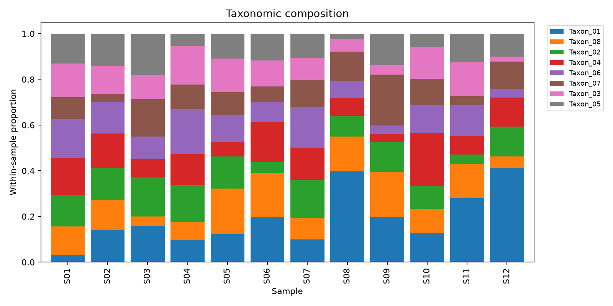

# See the result

Group A has a higher median Shannon diversity and less variation than Group B,
although the groups overlap. All samples contain eight detected taxa, so the
diversity differences reflect how evenly abundance is distributed among taxa.
This plot alone does not establish statistical significance.

Describe visible differences. These figures do not establish statistical significance or causation.
