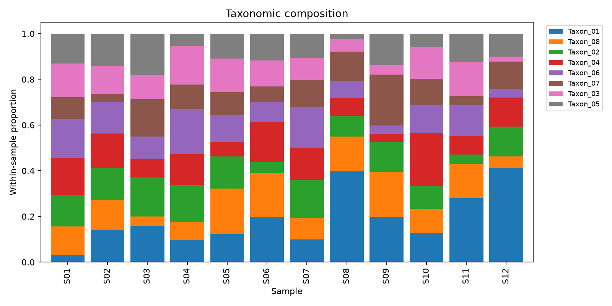
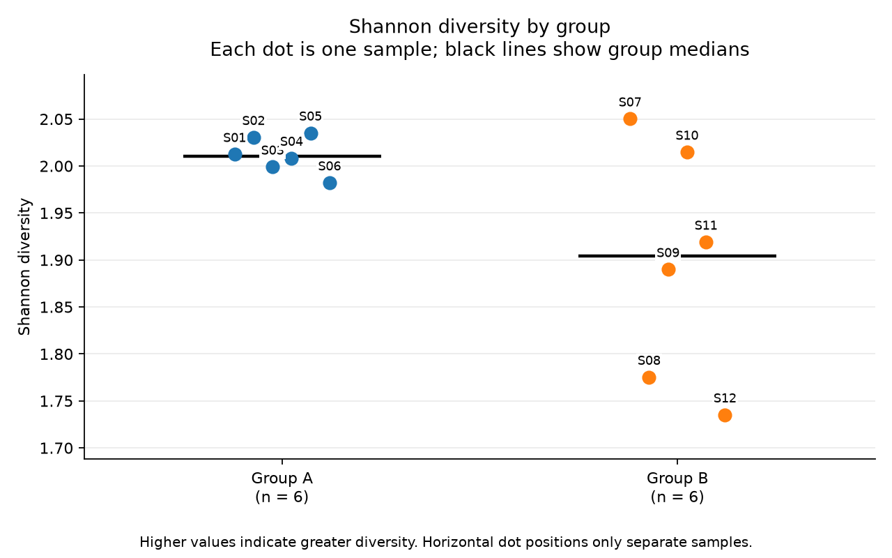
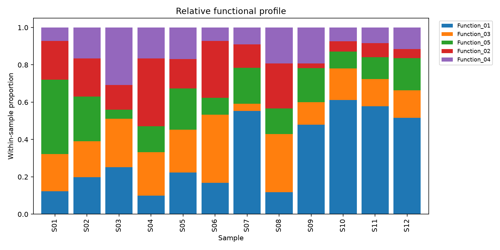

## Question

How do composition, diversity, and relative functional profiles differ between synthetic groups A and B?

## Inputs and methods

Describe the three input tables, arbitrary abundance units, normalization, natural-log Shannon calculation, and checks you ran. These data and functional labels are synthetic.

## Results

Replace this prompt with an observation supported by a saved table value.

Report a checked value and explain richness and evenness.

Describe relative differences without assigning biological pathway names to invented features.

## Verification

Record your sample ID, recalculated values, saved values, and whether they agree.

## Limitations and next check

The group differences were constructed. This descriptive analysis establishes no significance, causation, pathway activity, or clinical conclusions. Add another relevant limitation and a proposed follow-up check.
